# 시연 스크립트 — 캠퍼스 자동화 관제 플랫폼

> 대회 시연용. **7분**에 맞춰 짠 흐름입니다.
> 화면은 모두 실제로 도는 화면이고, 아래 그림은 그 화면을 그대로 찍은 것입니다.
> 손으로 만든 그림이나 목업은 하나도 없습니다.

---

## 0. 시연 전에 (5분)

### 서버 띄우기

```powershell
pnpm build
pnpm start
```

http://localhost:3000

> **`pnpm dev` 를 쓰지 마세요.** Next 16 개발 모드가 이 환경에서 불안정합니다.
> 렌더링 워커가 죽으면 주소에 ID 가 들어가는 상세 화면이 전부 500 을 냅니다.

### 상태 점검

시연 직전에 이 네 가지만 확인하면 됩니다.

| 확인할 것 | 있어야 하는 상태 |
|---|---|
| 검토 큐 `미검토` | **1건** — `[예시] 학생 문의 분류 도구` |
| 검토 큐 `검토 중` | **3건** — 그중 `[예시] 미팅 노트 자동 정리기` 는 체크리스트 미작성 |
| `[예시] 미팅 노트 자동 정리기` 2단계 | 중복 **92점 / 기존 도구에 합치기** 가 떠야 합니다 |
| 브라우저 | **로그아웃 상태**로 시작 |

어긋나 있으면 `pnpm demo:reset` 으로 되돌릴 수 있습니다. 다만 **직접 올리신
도구·수요·평가가 함께 지워집니다.**

### 브라우저

- 창 너비 **1024px 이상**. 그보다 좁으면 사이드바가 접힙니다.
- 확대/축소 **100%**.
- 로그인은 비밀번호 없이 카드를 누르면 됩니다.

---

## 전체 흐름

| | 막 | 계정 | 시간 | 화면 |
|---|---|---|---|---|
| 1 | 들어오기 | (없음) | 30초 | 랜딩 |
| 2 | **찾기** | 박수요 | 2분 | 맞춤 AI 찾기 → 결과 → 수요 초안 |
| 3 | 올리기 | 김개발 | 1분 | 도구 등록 |
| 4 | **검토하기** | 이검토 | 2분 30초 | 검토 큐 → 5단계 마법사 |
| 5 | 관리하기 | 최관리 | 1분 | 대시보드 · 순위 · 감사 로그 |

**2막과 4막이 핵심입니다.** 시간이 밀리면 3막과 5막을 줄이세요.

---

## 1막. 들어오기 (30초)

**화면** — http://localhost:3000 (로그아웃 상태)

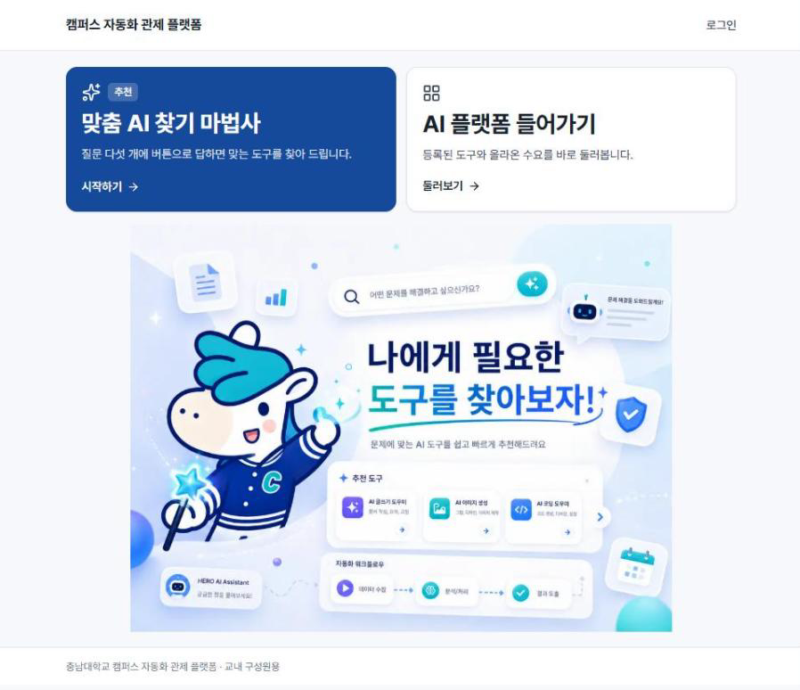

> "교내에서 만들어진 AI·업무 자동화 도구를 한 곳에 모으는 플랫폼입니다.
>
> 첫 화면에서 길을 두 개로 나눴습니다. 들어오는 사람이 두 부류이기 때문입니다.
> **뭐가 있는지 보러 온 사람**과 **자기 일이 힘들어서 온 사람**입니다.
>
> 뒤쪽 사람에게는 목록이 아무 도움이 안 됩니다. 자기 업무를 검색어로 바꿀 줄
> 알아야 쓸 수 있으니까요. 그래서 왼쪽에 마법사를 두고 색을 채웠습니다."

**누를 것** — 「맞춤 AI 찾기 마법사」 → 로그인 화면 → **박수요**

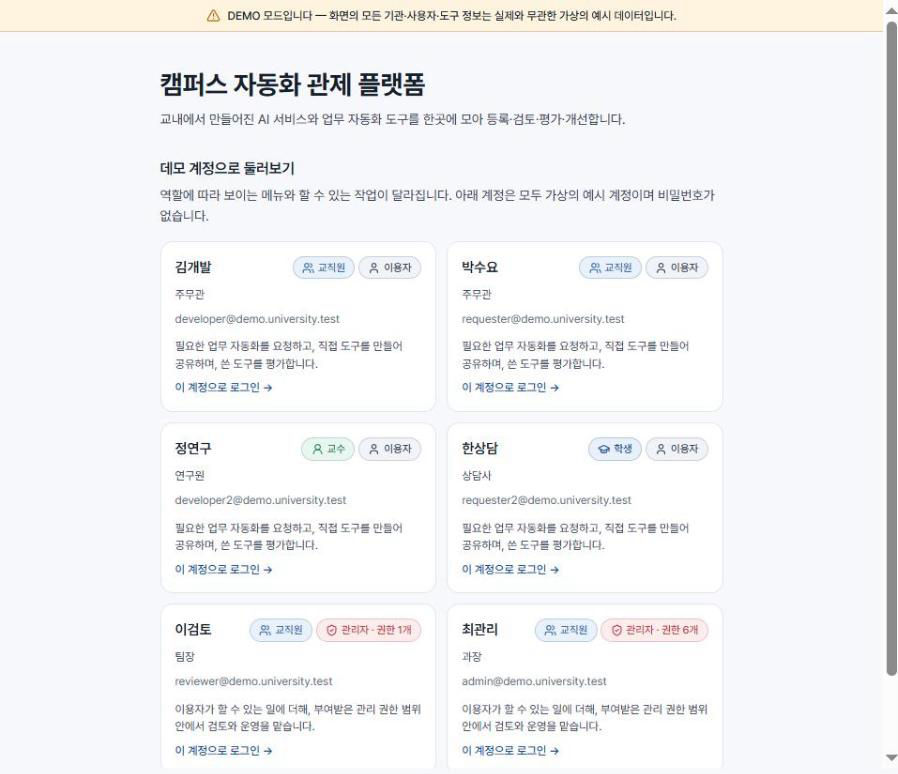

> "데모 계정 여섯 개입니다. 오른쪽 배지를 봐 주세요. 권한이 **역할 하나가 아니라
> 축 셋**입니다. 교직원이냐 학생이냐(학내 신분), 이용자냐 관리자냐(계정 유형),
> 그리고 **관리자가 받은 세부 권한 6종**입니다.
>
> 이검토는 권한 1개, 최관리는 6개입니다. **관리자라고 다 되는 게 아닙니다.**"

---

## 2막. 찾기 — 박수요 (2분)

### 2-1. 다섯 단계, 전부 버튼

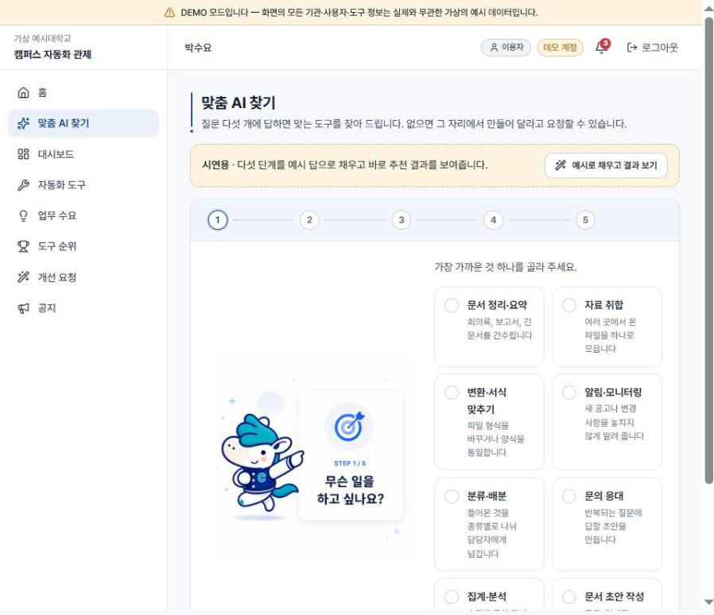

> "수요를 올리라고 하면 대개 빈 칸에 '업무를 설명하세요'라고 씁니다. 자기 일을
> 남에게 설명해 본 적 없는 사람에게 그건 어려운 숙제입니다.
>
> 그래서 다섯 단계를 **전부 고르는 것**으로 바꿨습니다. 서술형은 마지막 한 칸만
> 남겼고 그것도 선택입니다."

**누를 것** — 「예시로 채우고 결과 보기」(시연용 버튼)

> "시연이라 예시 답으로 한 번에 채우겠습니다. 실제로는 하나씩 누릅니다."

### 2-2. 이 화면이 이 플랫폼의 존재 이유입니다

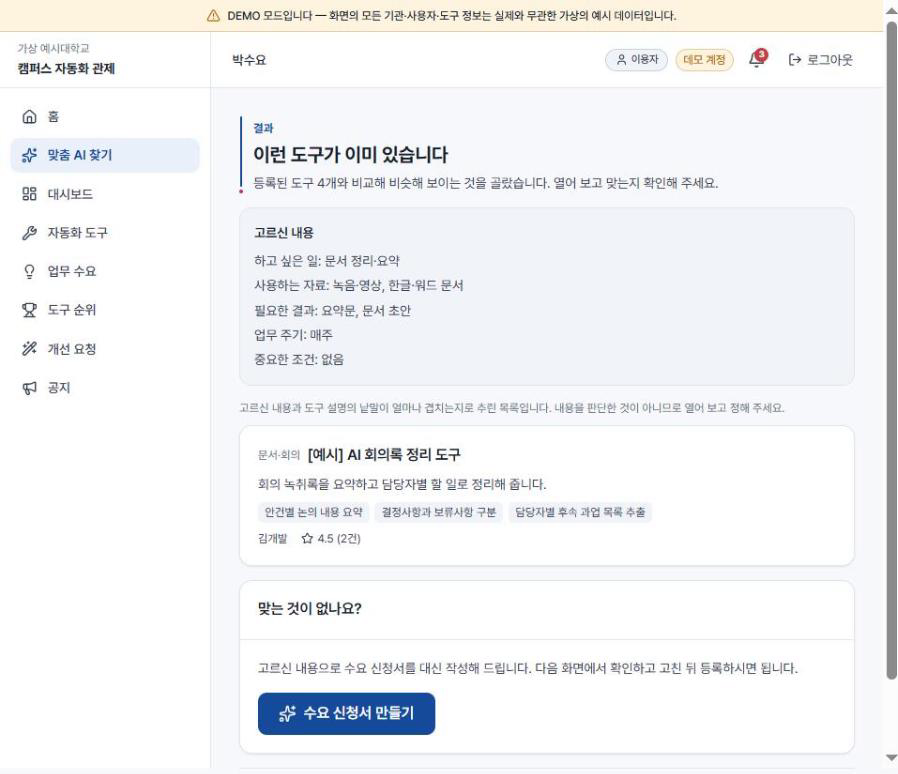

> "**'이런 도구가 이미 있습니다.'**
>
> 이게 이 플랫폼이 낼 수 있는 **가장 좋은 결과**입니다. 같은 것을 두 번 만들지
> 않는 것이 목적이니까요.
>
> 한 가지 짚고 넘어가겠습니다. **이 추천에는 모델을 쓰지 않았습니다.** 고르신
> 답과 도구 설명의 낱말이 얼마나 겹치는지 계산한 것입니다. 그래서 즉시 나오고,
> **왜 이게 추천됐는지 설명할 수 있습니다.** 화면에도 그렇게 적어 뒀습니다."

### 2-3. 없으면 그 자리에서 요청

**누를 것** — 「수요 신청서 만들기」 (10초쯤 걸립니다)

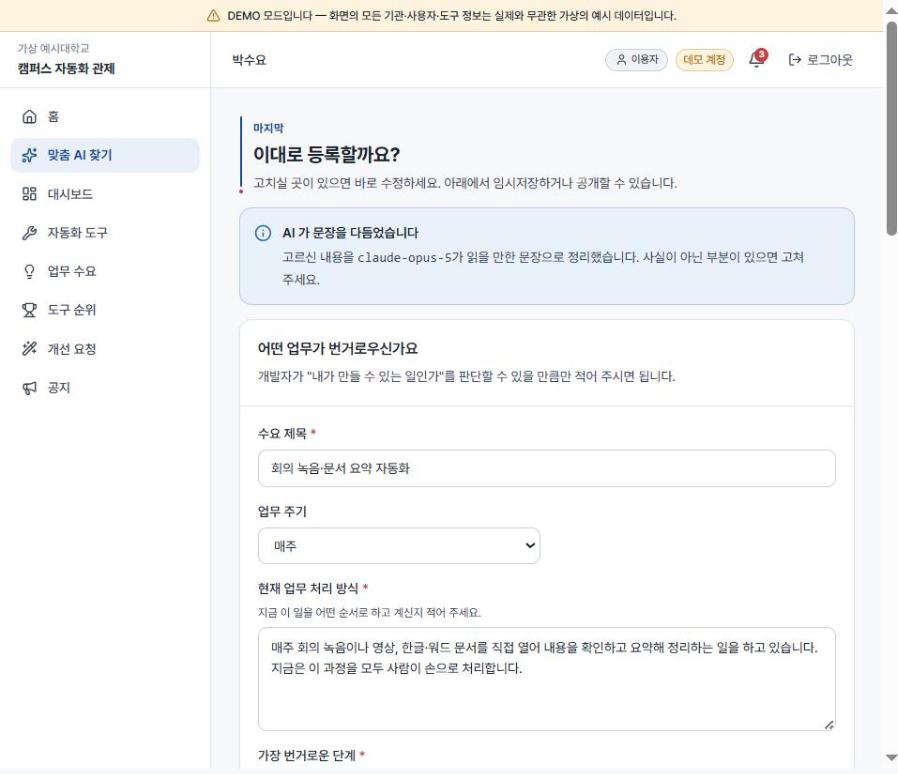

> "맞는 게 없을 때만 요청으로 넘어갑니다. 고르신 답을 **모델이 문장으로
> 다듬어** 신청서 초안을 만듭니다. 여기서만 화면이 모델을 부릅니다.
>
> 어느 모델이 썼는지 화면에 밝혀 뒀고, **'사실이 아닌 부분이 있으면 고쳐
> 주세요'** 라고 적었습니다. 모델이 쓴 글을 사람 글처럼 내보내지 않습니다.
>
> 그리고 이 호출이 실패해도 흐름은 끊기지 않습니다. 규칙으로 만든 초안으로
> 끝까지 갑니다."

---

## 3막. 올리기 — 김개발 (1분)

**계정 바꾸기** — 로그아웃 → 김개발

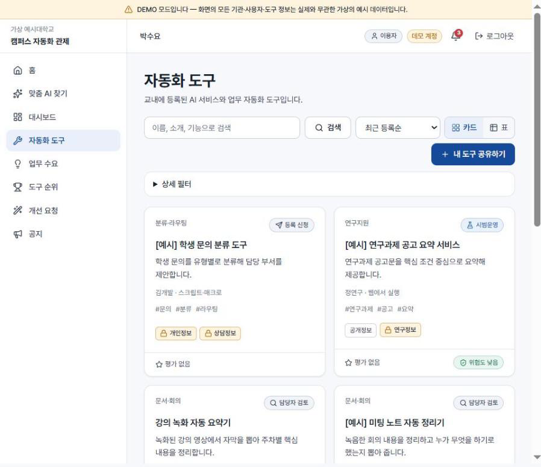

> "등록된 도구 목록입니다. 카드마다 **상태·다루는 데이터·위험도**가 함께
> 보입니다. 색만으로 구분하지 않고 글자와 아이콘을 같이 넣었습니다."

**누를 것** — 아무 승인된 도구

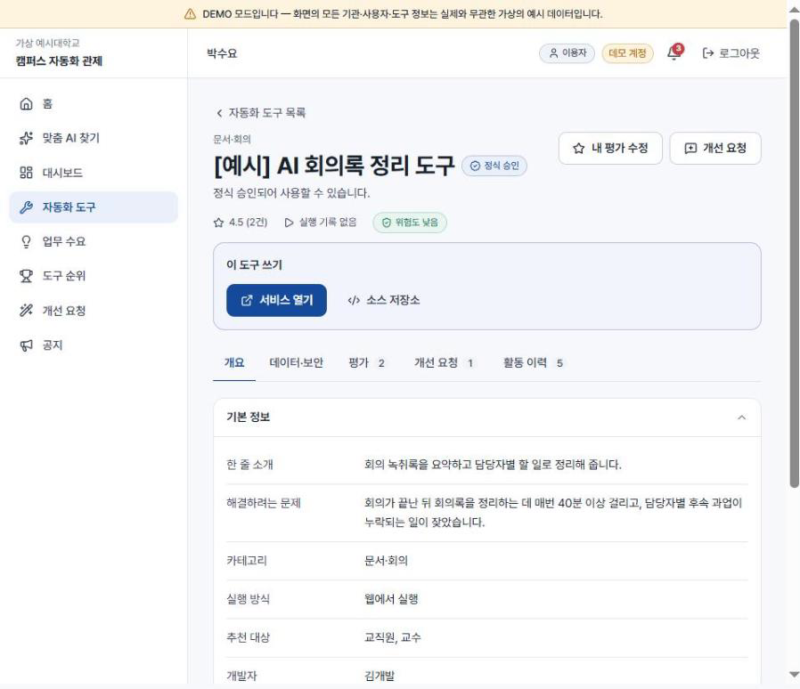

> "상세 화면 맨 위에 **「이 도구 쓰기」** 를 뒀습니다. 도구를 모아 두기만 하고
> 정작 실행할 방법이 없으면 목록집일 뿐입니다. 웹이면 열고, 프로그램이면
> 내려받고, 소스가 있으면 저장소로 갑니다."

**누를 것** — 자동화 도구 → 「내 도구 공유하기」

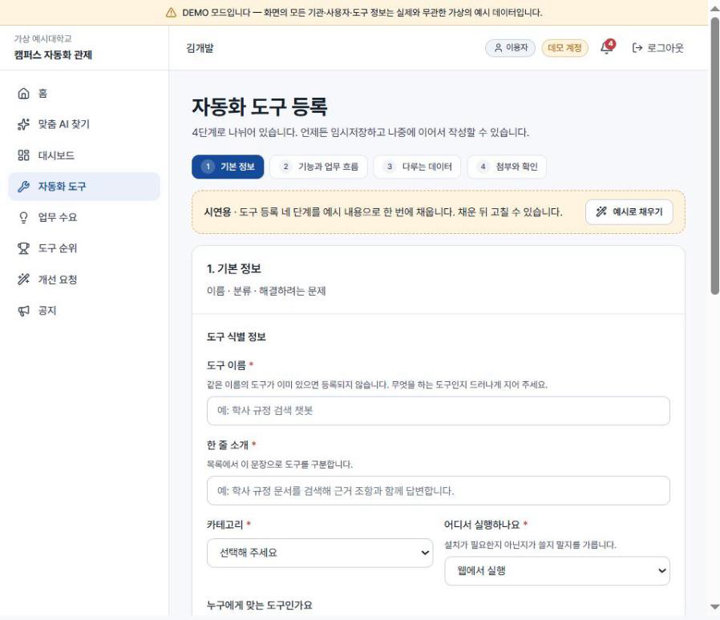

> "등록은 네 단계입니다. 시연이라 **「예시로 채우기」** 로 한 번에 채우겠습니다.
>
> 3단계에서 **다루는 데이터**를 고르게 합니다. 개인정보·성적·상담 같은 민감
> 분류를 고르면 그 자리에서 경고가 뜹니다. 등록할 때 답하지 않으면 검토자가
> 나중에 물어봐야 하고, 그러면 한 바퀴가 더 돕니다."

> **말해 두면 좋은 것** — 신청하려면 **쓸 수 있는 경로**(주소·프로그램 파일·소스
> 저장소) 중 하나는 반드시 있어야 합니다. 없으면 신청이 막힙니다.

---

## 4막. 검토하기 — 이검토 (2분 30초) ★핵심

**계정 바꾸기** — 로그아웃 → 이검토

### 4-1. 검토자의 일 순서대로 묶은 큐

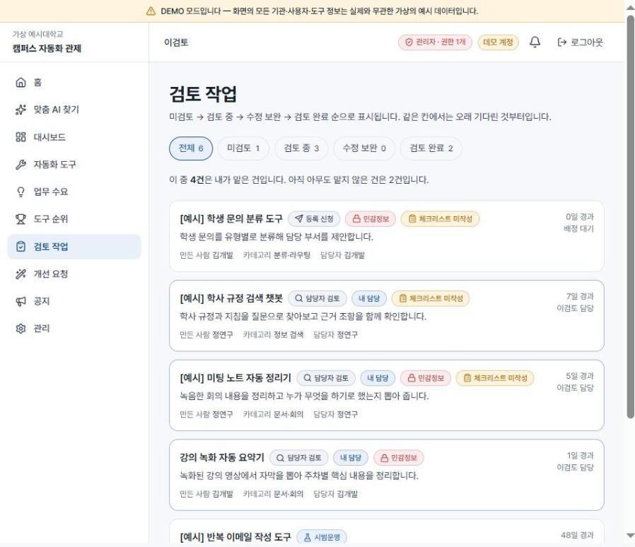

> "검토 큐입니다. 도구 상태를 그대로 늘어놓지 않고 **검토자의 일 순서**로
> 묶었습니다 — 미검토, 검토 중, 수정 보완, 검토 완료.
>
> 같은 칸 안에서는 **오래 기다린 것부터** 올라옵니다."

**누를 것** — 미검토의 `[예시] 학생 문의 분류 도구`

### 4-2. 검토 시작

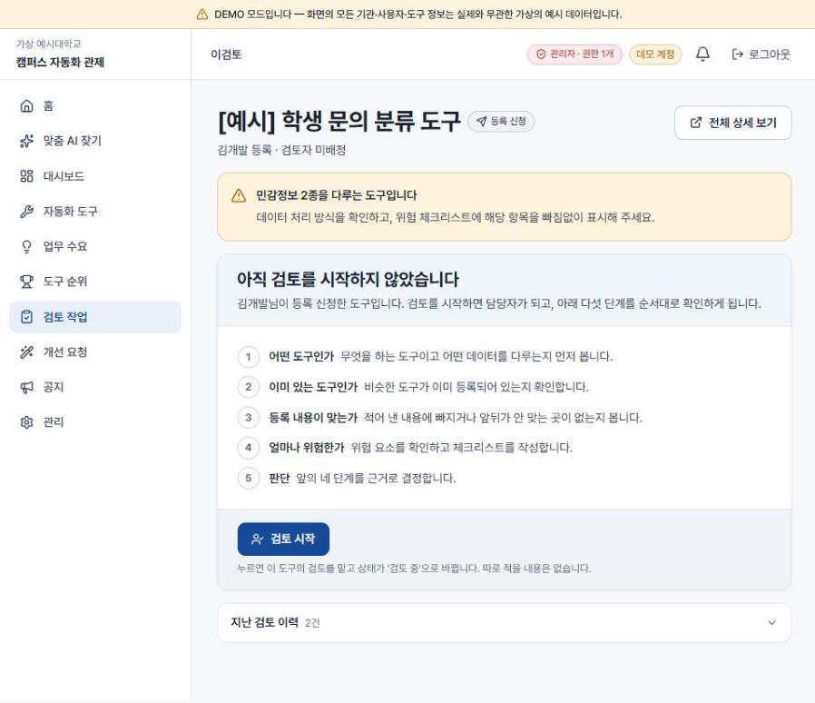

> "아직 아무도 맡지 않은 건입니다. **무엇을 하게 되는지 다섯 단계를 먼저
> 보여 주고** 시작합니다.
>
> 누르면 담당자가 되고 상태가 '검토 중'으로 바뀝니다. **따로 적을 내용은
> 없습니다.** 착수에 불과한 일에 이유를 적으라고 하면 매번 '확인하겠습니다'를
> 치게 되고, 그러면 정작 이유가 중요한 곳에서도 대충 적게 됩니다."

**여기서 되돌아 나옵니다** — 큐로 돌아가 `[예시] 미팅 노트 자동 정리기` 를 엽니다.
(이미 검토 중이라 1단계부터 바로 보입니다.)

### 4-3. 1단계 — 어떤 도구인가

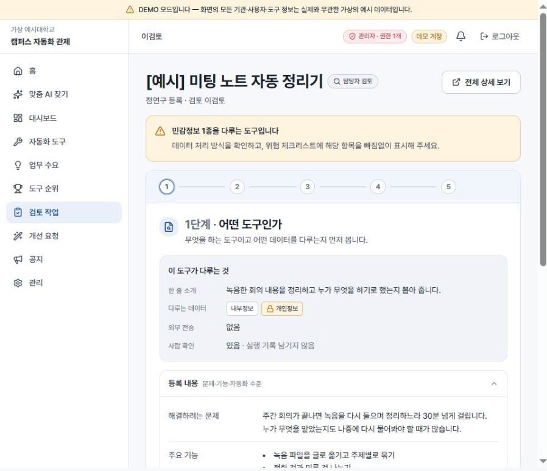

> "한 번에 한 단계씩 봅니다. 전에는 카드 여섯 장이 한 화면에 쌓여 있었는데,
> 그러면 **맨 아래 승인 버튼으로 바로 내려가는 것을 막을 방법이 없습니다.**
>
> 1단계는 이 도구가 무엇을 하고 어떤 데이터를 다루는지입니다. 확인하셨다고
> 표시해야 다음으로 넘어갑니다."

### 4-4. 2단계 — 중복 자동화 탐지 ★

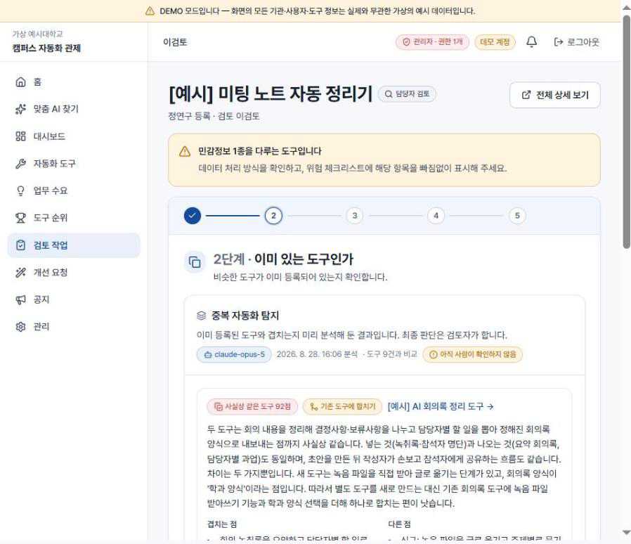

> "**이 화면을 봐 주십시오.**
>
> `사실상 같은 도구 92점` · `기존 도구에 합치기`.
>
> 이미 등록된 「AI 회의록 정리 도구」와 사실상 같다는 판정입니다. 그냥 점수만
> 던지지 않고 **겹치는 점과 다른 점을 나눠서** 근거를 댑니다.
>
> 어떻게 찾았느냐 — **두 단계입니다.** 먼저 글자 겹침을 계산해 후보를 좁히고,
> 그다음 **그 후보만** 모델에게 물어봅니다. 전부를 모델에 넣으면 비용이 도구 수의
> 제곱으로 늡니다.
>
> 두 단계로 나눈 값어치가 여기서 나옵니다. 화면 아래 「겹치는 점」을 보시면
> **'회의 녹취록 텍스트'와 '회의 녹음 파일 또는 받아쓴 글'** 을 같은 것으로
> 묶었습니다. **낱말은 겹치지 않는데 하는 일이 같다**는 걸 잡은 겁니다. 글자
> 겹침 계산만으로는 절대 못 합니다.
>
> 그리고 배지 하나를 봐 주세요 — **`아직 사람이 확인하지 않음`**. 모델이 판정을
> 냈다고 끝난 게 아닙니다. 최종 판단은 검토자가 합니다."

### 4-5. 3단계 — 멀티 LLM 품질검증

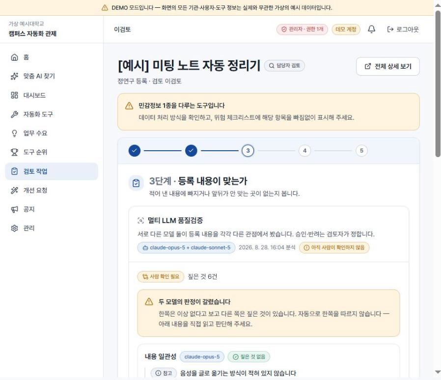

> "서로 다른 모델 둘이 등록 내용을 **각각 다른 관점에서** 봤습니다.
>
> 여기서 중요한 건 이 문구입니다 — **'두 모델의 판정이 갈렸습니다.'**
>
> 한쪽은 이상 없다고 보고 다른 쪽은 짚은 것이 있습니다. **자동으로 한쪽을
> 따르지 않습니다.** 갈렸다는 사실을 그대로 보여 주고 사람이 읽게 합니다.
> 평균을 내거나 다수결로 덮으면, 갈렸다는 정보 자체가 사라집니다."

### 4-6. 4단계 — 위험도

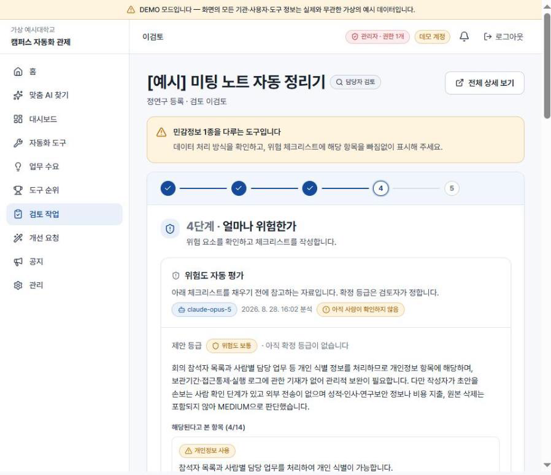

> "모델이 제안한 등급과 그 이유입니다. 14개 항목 중 4개가 해당된다고 봤습니다."

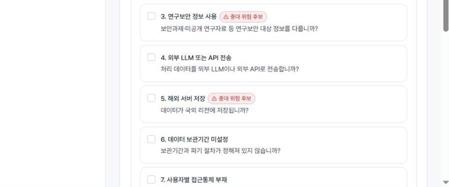

> "그리고 아래가 **사람이 직접 채우는 14항목 체크리스트**입니다.
>
> **AI 제안으로 이 체크리스트를 자동으로 채우지 않습니다.** 채워 두면 검토자가
> 그대로 넘깁니다. 제안은 체크리스트 **위에 따로** 보여 주고, 표시는 사람이
> 합니다. 해당된다고 표시하면 **어떤 통제를 적용했는지 적어야** 저장됩니다.
>
> 이 단계는 **체크리스트를 저장해야** 다음으로 넘어갑니다."

### 4-7. 5단계 — 판단

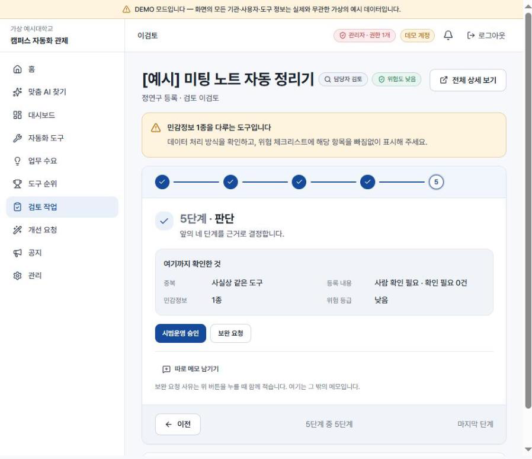

> "앞의 네 단계에서 나온 결론만 한 줄씩 모았습니다. 그 위에서 결정합니다.
>
> 안 본 것은 **'아직 확인하지 않음'** 이라고 씁니다. 0이나 '없음'으로 채우지
> 않습니다. **없는 것과 확인하지 않은 것은 다릅니다.**
>
> 「시범운영 승인」과 「보완 요청」의 모양을 다르게 했습니다. 마지막 단계에서
> 가장 잘못 누르기 쉬운 것이 이 둘이라서요.
>
> 위험도를 '매우 높음'으로 저장하면 **서버가 시범운영과 정식 승인을 막습니다.**
> 화면에서 버튼을 감춘 게 아니라, 다른 경로로 요청이 들어와도 막힙니다."

---

## 5막. 관리하기 — 최관리 (1분)

**계정 바꾸기** — 로그아웃 → 최관리

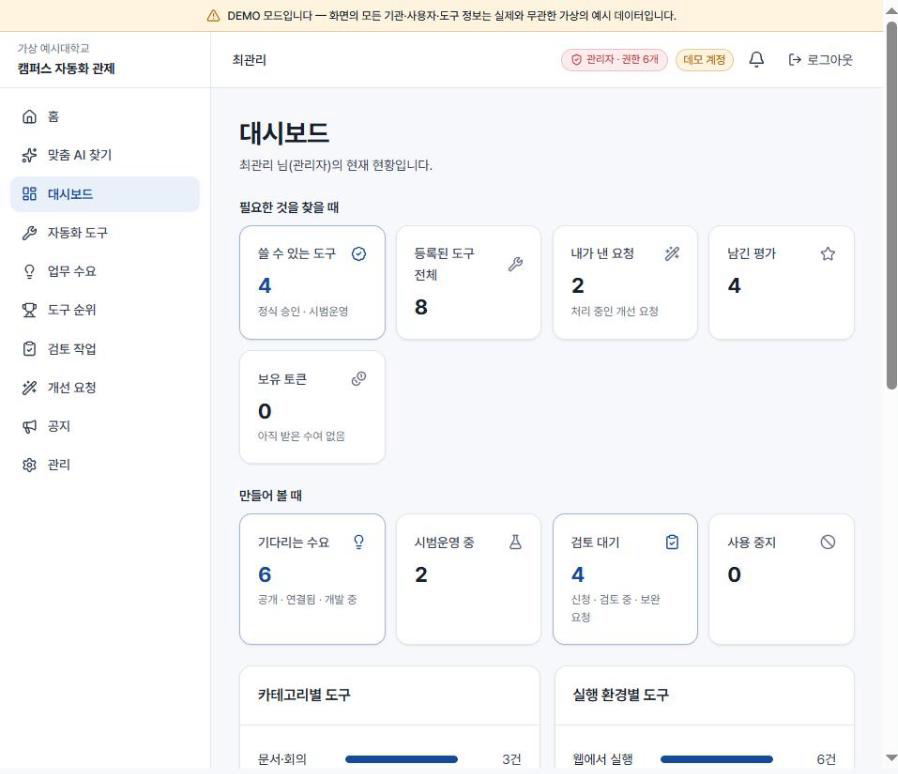

> "관리자 대시보드입니다. **'필요한 것을 찾을 때'와 '만들어 볼 때'** 로 나눴습니다.
> 숫자를 늘어놓지 않고 그 숫자로 무엇을 할지로 묶었습니다."

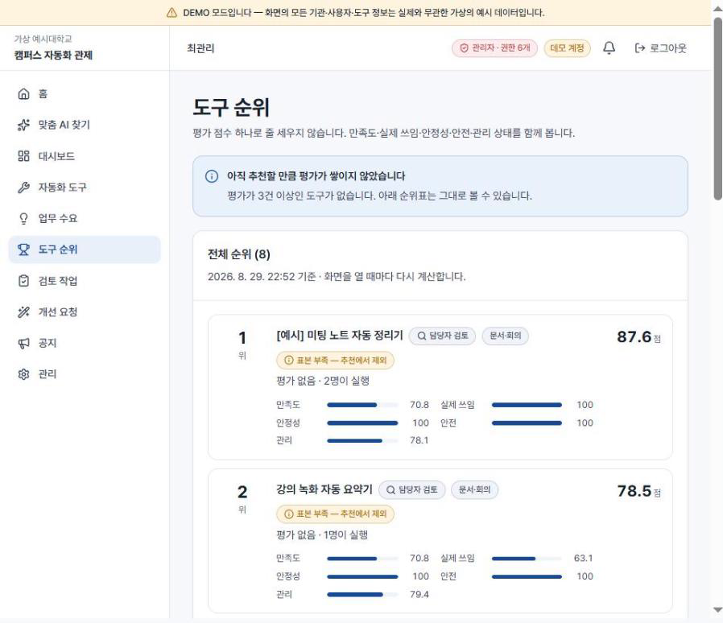

> "순위입니다. **평가 점수 하나로 줄 세우지 않습니다.** 만족도·실제 쓰임·안정성·
> 안전·관리 다섯 축을 함께 봅니다.
>
> 그리고 이 배지 — **`표본 부족 — 추천에서 제외`**. 평가가 3건이 안 되면
> 추천하지 않습니다. 한 사람이 별 다섯 개 준 도구가 1등이 되면 순위가 의미를
> 잃습니다.
>
> **이 순위에는 모델을 쓰지 않습니다.** 순수한 계산입니다. 그래서 '왜 이
> 순위냐'에 답할 수 있습니다."

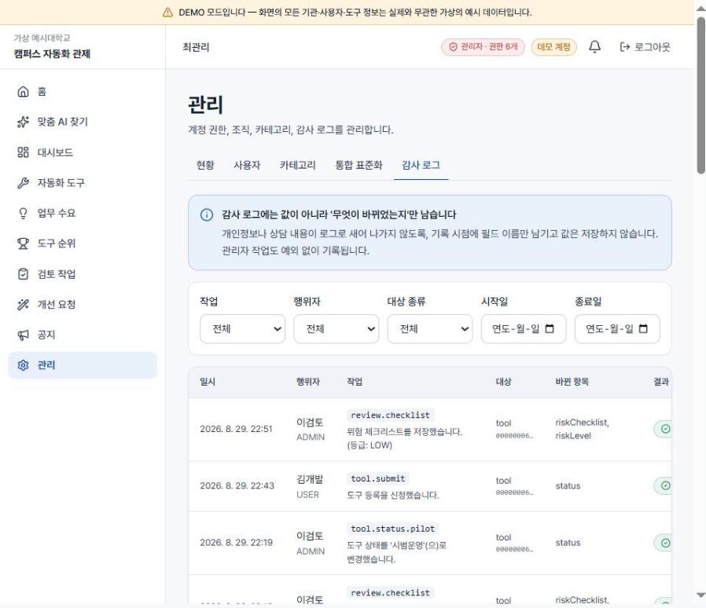

> "마지막으로 감사 로그입니다. 문구를 읽어 드리겠습니다.
>
> **'감사 로그에는 값이 아니라 무엇이 바뀌었는지만 남습니다.'**
>
> 개인정보나 상담 내용이 로그로 새어 나가지 않도록, **바뀐 필드 이름만 남기고
> 값은 저장하지 않습니다.** 그리고 **관리자 작업도 예외 없이 기록됩니다.**"

---

## 시간이 남으면

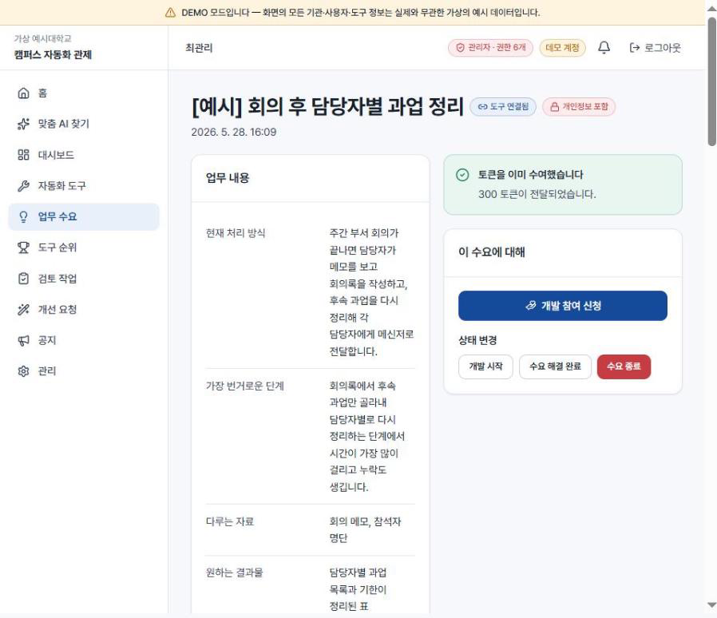

- **수요-도구 매칭** — 올라온 수요에 대해 기존 도구로 해결되는지 모델이 확인합니다.
  덮는 기능과 못 덮는 기능을 나눠서 보여 줍니다.
- **토큰** — 수요를 해결해 준 개발자에게 토큰이 갑니다. 만드는 사람에게 돌아가는
  것이 있어야 계속 올라옵니다.
- **개선 요청** — 쓰다가 불편한 점을 도구에 붙여 남깁니다.
- **통합 표준화** (`관리 → 통합 표준화`) — 비슷한 도구 묶음을 찾아 통합 후보로 냅니다.

---

## 심사위원이 물을 만한 것

**"AI가 승인까지 자동으로 하나요?"**
> 아닙니다. AI는 **제안만** 합니다. 위험 체크리스트는 사람이 채우고, 등급도 사람이
> 정하고, 승인도 사람이 누릅니다. 화면에 `아직 사람이 확인하지 않음` 배지를 둔
> 이유가 그것입니다.

**"분석에 시간이 얼마나 걸리나요? 화면이 느려지지 않나요?"**
> 화면에서는 모델을 부르지 않습니다. **분석은 스크립트가 미리 돌려 두고**, 앱은
> 저장된 결과를 읽기만 합니다. 그래서 화면은 즉시 뜨고, 같은 화면을 열 때마다
> 같은 결과가 나옵니다. 비용도 예측됩니다.
> 실제로 돌린 수치는 **47회 실행 · 약 $1.7** 입니다.
> (예외 하나 — 수요 초안 다듬기만 화면에서 부릅니다. 실패해도 규칙 초안으로 갑니다.)

**"분석 결과가 없으면 어떻게 되나요?"**
> **"아직 돌리지 않았습니다"** 라고 씁니다. 0으로 채우거나 흐린 숫자·자리표시용
> 그래프를 그리지 않습니다.

**"개인정보는 모델에 안 가나요?"**
> 모델로 나가는 내용은 **허용 목록을 거칩니다.** 도메인 타입에 필드가 새로 생겨도
> 그 목록에 적지 않으면 나가지 않습니다. 등록자·검토자 이름, 이메일, 부서는
> 나가지 않습니다.

**"실제 데이터인가요?"**
> 아닙니다. 화면 맨 위에 항상 DEMO 배너가 뜨고 도구명에 `[예시]` 가 붙습니다.
> 이메일은 실재하지 않는 예약 도메인(`demo.university.test`)을 씁니다.

**"저장소는 무엇인가요?"**
> 지금 시연은 파일 기반 데모 저장소입니다. Supabase 용 스키마와 구현이 함께 들어
> 있고 저장소 인터페이스가 같아서, 환경변수만 바꾸면 붙습니다. **다만 아직
> 실제로 연결해 돌려 보지는 않았습니다.**

---

## 시연에서 하지 말 것

- **`pnpm dev` 로 띄우지 마세요.** 상세 화면이 500 을 냅니다.
- **`pnpm demo:reset` 을 시연 직전에 돌리지 마세요.** 직접 올리신 도구·수요·평가가
  지워집니다.
- **`강의 녹화 자동 요약기` 의 2·3단계를 열지 마세요.** 새 버전이라 분석이 비어
  있어 "아직 돌리지 않았습니다"가 뜹니다. 정직한 표시이지만 시연에서는 설명이
  길어집니다. 검토 시연은 **`[예시] 미팅 노트 자동 정리기`** 로 하세요.
- **없는 기능을 있다고 말하지 마세요.** 특히 Supabase 연결, 도구 '반려' 상태,
  관리자 디자인 편집은 아직 없습니다.

---

## 화면 그림 목록

| 파일 | 화면 |
|---|---|
| `01-landing.png` | 랜딩 |
| `02-login.png` | 로그인 (권한 3축) |
| `03-wizard-step1.png` | 맞춤 AI 찾기 1단계 |
| `04-wizard-result.png` | 추천 결과 — "이런 도구가 이미 있습니다" |
| `05-demand-draft.png` | AI 가 다듬은 수요 초안 |
| `06-tools-list.png` | 도구 목록 |
| `07-tool-detail.png` | 도구 상세 — 이 도구 쓰기 |
| `08-tool-register.png` | 도구 등록 4단계 |
| `09-review-queue.png` | 검토 큐 |
| `10-review-start.png` | 검토 시작 |
| `11-review-step1.png` | 검토 1단계 — 어떤 도구인가 |
| `12-review-step2-duplicate.png` | 검토 2단계 — **중복 92점** |
| `13-review-step3-quality.png` | 검토 3단계 — 멀티 LLM, 판정 갈림 |
| `14-review-step4-risk.png` | 검토 4단계 — 위험도 제안 |
| `15-risk-checklist.png` | 14항목 체크리스트 |
| `16-review-step5-decision.png` | 검토 5단계 — 판단 |
| `17-dashboard.png` | 대시보드 |
| `18-ranking.png` | 도구 순위 (5축 · 표본 부족 표시) |
| `19-audit-log.png` | 감사 로그 |
| `20-demand-detail.png` | 수요 상세 · 토큰 수여 |

모두 2026-08-29 에 실제 화면을 찍은 것입니다. 손댄 곳은 없습니다.
