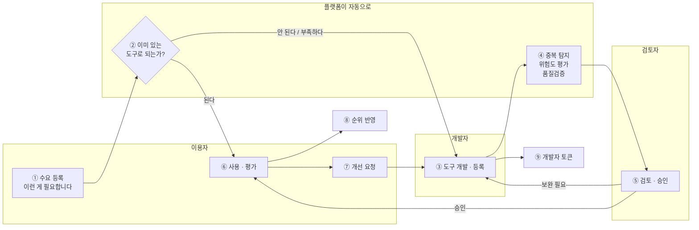
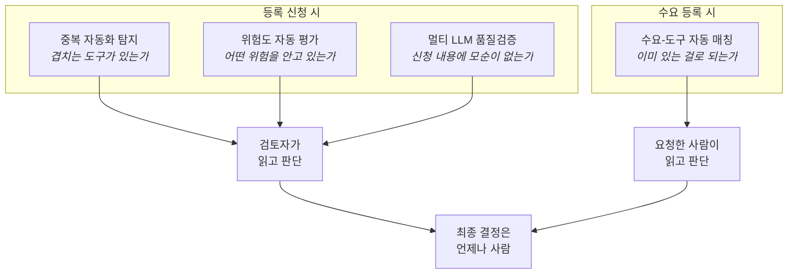
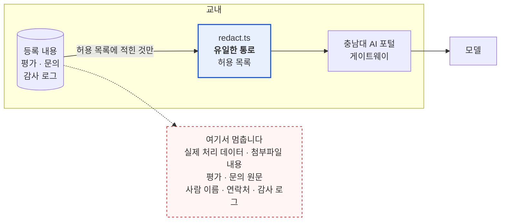
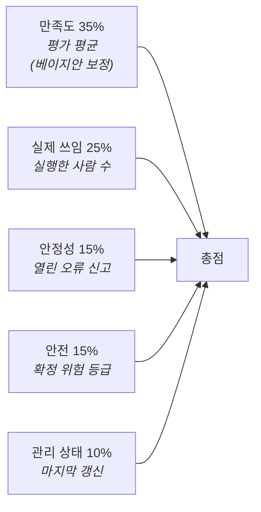
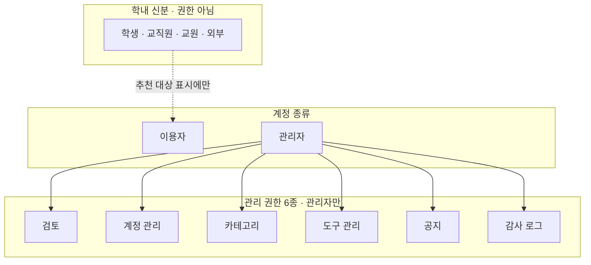
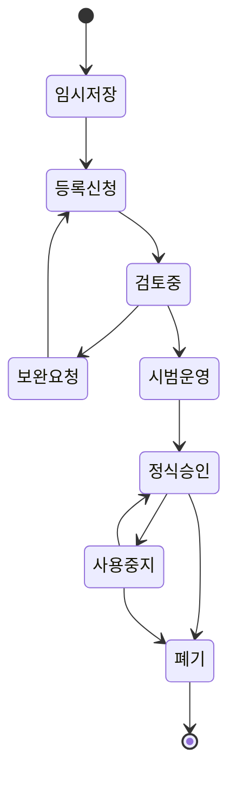
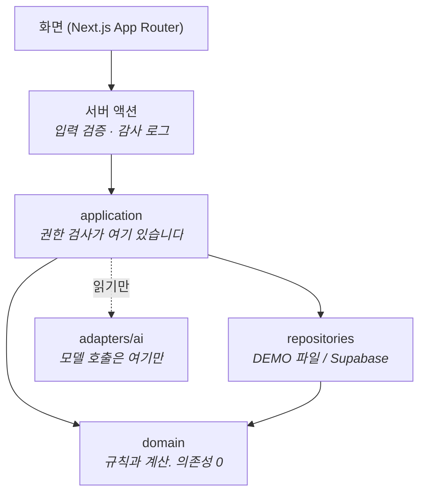

# 캠퍼스 자동화 관제 플랫폼 — 구조 한눈에

> 심사위원용 요약 문서입니다. 기술 용어는 맨 끝으로 미뤄 두었습니다.

---

## 1. 무엇을 푸는 플랫폼인가

대학 안에서 AI·업무 자동화 도구가 **제각각 만들어지고 있습니다.**
문제는 도구가 많다는 것이 아니라, **아무도 전체를 못 본다**는 것입니다.

| 지금 벌어지는 일 | 이 플랫폼이 하는 일 |
| --- | --- |
| 옆 부서가 같은 걸 이미 만들었는데 모르고 또 만든다 | 등록할 때 **겹치는 도구를 찾아 알려 준다** |
| 개인정보를 다루는 도구가 검토 없이 돌아간다 | 등록 내용에서 **위험 항목을 짚어 검토자에게 넘긴다** |
| 신청서에 앞뒤가 안 맞는 내용이 있어도 넘어간다 | **서로 다른 모델 둘이 교차 확인**한다 |
| "이런 게 필요하다"는 요청이 기존 도구와 안 이어진다 | **이미 있는 걸로 되는지** 먼저 확인한다 |
| 뭐가 좋은 도구인지 알 수 없다 | 평가·사용·안정성·안전을 함께 봐 **순위**를 낸다 |
| 만든 사람에게 돌아가는 것이 없다 | **개발자 토큰**으로 기여를 기록한다 |

---

## 2. 전체 흐름



**핵심은 ②와 ④입니다.** 나머지는 어느 플랫폼에나 있지만, 이 둘이 "관제"를
만듭니다 — 만들기 전에 한 번, 등록할 때 한 번 걸러 냅니다.

---

## 3. AI가 하는 일 네 가지



### 지킨 원칙 셋

**① AI는 제안하고, 사람이 확정합니다.**
위험 등급을 AI가 정하지 않습니다. 검토자가 쓰는 것과 **같은 14개 항목**에 대해
의견과 근거를 낼 뿐이고, 체크박스는 **자동으로 채우지 않습니다.**
채워 두면 검토자가 그대로 넘기게 되고, 그러면 검토가 없는 것과 같습니다.
모델 제안과 검토자 판단이 갈리면 그 사실을 화면에 그대로 보여 줍니다.

**② 없는 것을 지어내지 않습니다.**
분석을 돌리지 않았으면 "아직 돌리지 않았습니다"라고 씁니다. 0점으로 채우거나
흐린 숫자·자리표시용 그래프를 그리지 않습니다. 화면에 숫자가 있으면 그건
전부 실제로 계산되거나 판단된 값입니다.

**③ 모든 판단에 출처가 붙습니다.**
어느 모델이 언제 냈는지, 사람이 확인했는지가 화면에 함께 나옵니다.
"AI가 판단했습니다"만으로는 아무 말도 아닙니다.

---

## 4. 개인정보는 어디까지 나가는가

학내 플랫폼이라 가장 중요한 질문입니다. **코드로 답할 수 있게** 만들었습니다.



- **나가는 것**: 도구 이름, 소개, 기능 목록, 업무 흐름 설명, 데이터 분류의 **이름**
  — 전부 등록자가 "이런 도구입니다"라고 공개하려고 쓴 글입니다.
- **나가지 않는 것**: 도구가 실제로 처리한 데이터, 첨부파일 내용, 평가·문의 원문,
  사람 이름과 연락처, 감사 로그.
- **통로가 하나뿐입니다.** 허용 목록 방식이라 나중에 필드가 늘어도 여기 적지
  않으면 자동으로 새어 나가지 않습니다.
- 통과한 뒤에도 연락처·주민등록번호·이메일·학번 패턴을 **한 번 더 가립니다.**
  등록자가 설명에 실수로 적어 넣었을 수 있기 때문입니다.
- 모델 회사에 직접 붙지 않고 **충남대 AI 포털**을 거칩니다. 키도 학교가 관리합니다.

### 사람 이름을 빼는 또 다른 이유

개인정보 때문만이 아닙니다. "김개발이 만든 도구"라고 보내면 모델 판단에 사람이
끼어듭니다. **도구를 도구로만 비교하려면 만든 사람이 누구인지 몰라야 합니다.**

---

## 5. 순위는 AI가 아닙니다

요구사항의 "순위 추천"입니다. 여기에는 **모델을 부르지 않습니다.**
있는 기록을 세는 계산이고, 부르면 오히려 "왜 이 순위냐"에 답할 수 없게 됩니다.



**평균 평점으로 줄 세우지 않는 이유**: 평가 3건에 5.0점인 도구가 평가 40건에
4.3점인 도구를 이깁니다. 그건 추천이 아니라 표본 부족입니다. 학내에서는 특히
나쁘게 작동합니다 — 만든 사람이 아는 사람 몇 명에게 부탁하면 1위가 됩니다.

축별 점수를 막대로 펼치고 가중치를 화면에 그대로 적습니다. 총점만 보이면
도구를 만든 사람이 무엇을 고쳐야 할지 알 수 없습니다.

---

## 6. 권한 — 역할 하나가 아니라 축 셋



- **관리자라고 다 되는 것이 아닙니다.** 검토 권한만 받은 관리자는 계정 관리에
  못 들어갑니다.
- **관리 권한으로 소유권을 넘지 못합니다.** 관리자도 남의 도구 내용이나 남이 쓴
  평가는 고칠 수 없습니다.
- **이용자끼리는 구분하지 않습니다.** 누구나 수요를 올리고 누구나 도구를 만듭니다.
- 학내 신분은 권한이 아니라 "이 도구는 학생에게 추천" 같은 표시에만 씁니다.

---

## 7. 도구가 거치는 단계



위험 등급이 높은 도구는 **체크리스트 없이 승인할 수 없습니다.** 단계 전환 규칙은
화면이 아니라 도메인 계층이 판단하므로, 화면을 우회해도 규칙이 지켜집니다.

---

## 8. 기술 구조 (참고)



- **화면은 저장소를 직접 부르지 못합니다.** 부르면 권한 검사와 감사 로그를
  건너뛰게 되므로, 규칙으로 막아 두었습니다(빌드 전에 차단됩니다).
- **`domain` 은 아무것도 import 하지 않습니다.** 순위 계산, 상태 전환 규칙,
  중복 묶기가 전부 여기 있고 단위 테스트로 검증됩니다.
- **분석은 미리 돌리고 화면은 저장된 것만 읽습니다.** 페이지를 열 때마다 모델을
  부르면 느리고 비싼 데다, 새로 고칠 때마다 판단이 달라지면 검토 자료로 쓸 수
  없습니다.

### 규모

| 항목 | 수치 |
| --- | --- |
| 화면 | 24개 |
| 자동 테스트 | 392개 (단위 · 통합) |
| 전체 흐름 E2E | 6개 시나리오 |
| 데모 분석 실행 | 32회 호출 · 약 $1.2 |

### 검증

```powershell
pnpm lint && pnpm typecheck && pnpm test && pnpm build
pnpm test:e2e
```

---

## 9. 더 볼 것

| 문서 | 내용 |
| --- | --- |
| [PROGRESS.md](PROGRESS.md) | 지금까지 무엇을 만들었고 왜 그렇게 했는지 |
| [ROADMAP-AI.md](ROADMAP-AI.md) | AI 기능 설계와 실제로 겪은 문제들 |
| [DECISIONS.md](DECISIONS.md) | 되돌리기 전에 읽어야 할 결정들 |
| [SECURITY.md](SECURITY.md) | 권한·개인정보 처리 |
| [ARCHITECTURE.md](ARCHITECTURE.md) | 계층 구조 상세 |
